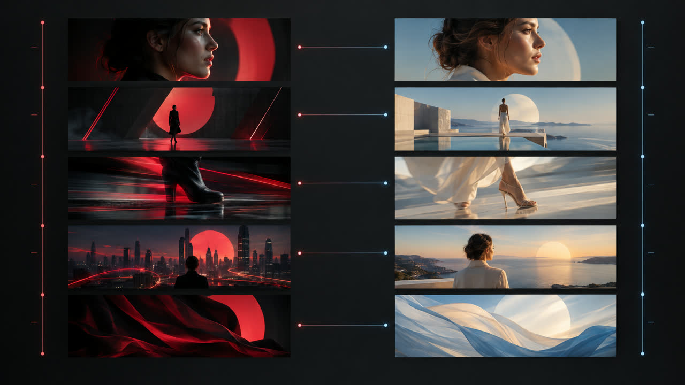

# Replicate a video

A skill for [OpenFilm](https://github.com/openfilm/openfilm): give it a video, and it is made again in OpenFilm, frame
for frame or with your own content, every moment matched and every part editable.



## Why it measures

An agent sees still pictures, not a video. Looking at frames, it gets the look of a video right and its timing wrong:
it misses cuts between the frames it looked at, moves things at an even pace where the video eases, and keeps its own
clock. So this skill gives the agent a measure of time:

- `measure.mjs study <video>` turns the video into a timeline read to the frame: its cuts; each change, where in the
  frame it happens and how its pace rises and falls; the stretches where it holds still; its sound's hits and beat.
- `measure.mjs compare <reference> <render>` measures the remake against it: every cut, change and hit matched with its
  offset in frames, each change's pace and length, a rhythm score, how alike the pictures are shot by shot, and
  side-by-side pictures of where they differ most.

Both need only Node and ffmpeg, which OpenFilm needs too, and take seconds.

## Use it

- **In OpenFilm**: it comes with it. Pick it in the chat, or ask for a remake of a video.
- **In your own agent** (Claude Code, Codex and others):

  ```sh
  npx skills add openfilm/openfilm
  npx skills add openfilm/skill-replicate
  ```

## This repository

| | |
| --- | --- |
| `skills/replicate/` | the skill: everything in it is what the agent gets |
| `evals/` | the real requests it is tried on, and what was measured |
| `CHANGELOG.md` | what changed in each version |

How a skill for OpenFilm is written: [SPEC.md](https://github.com/openfilm/skills/blob/main/SPEC.md).

## License

[MIT](LICENSE).
